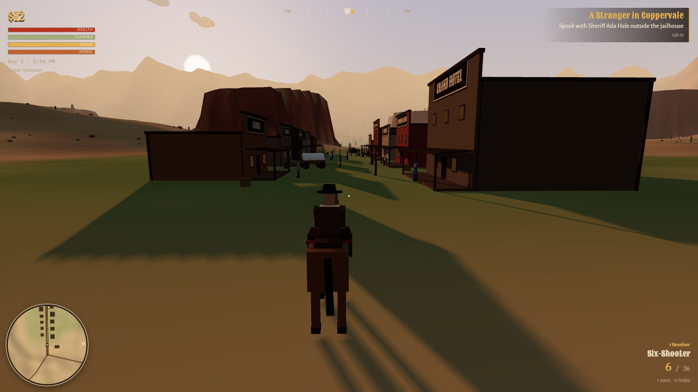
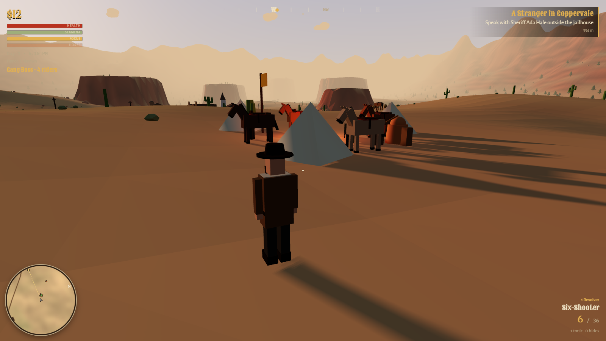
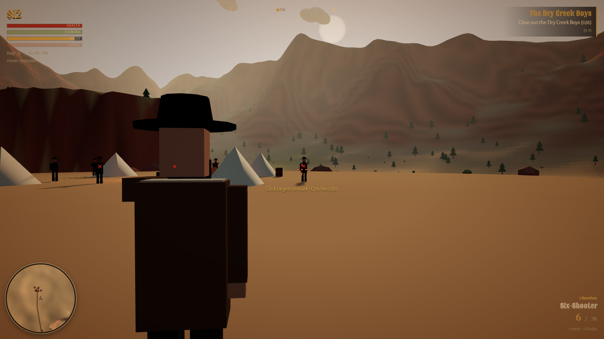
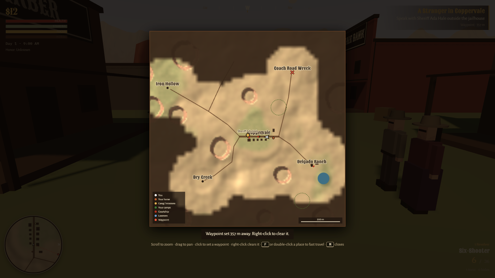
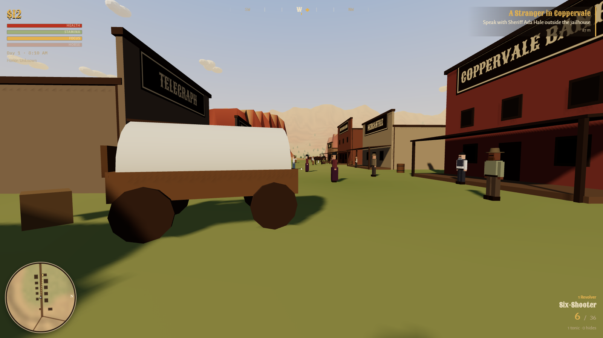

<div align="center">

# Dust & Iron

**An open-world Western you play in the browser.**<br>
Ride into a copper town, take on the gang bleeding it dry, or become the outlaw who runs the territory.

### [▶ Play in your browser](https://advaithsajith.github.io/dust-and-iron/) &nbsp;·&nbsp; [How to play](#how-to-play) &nbsp;·&nbsp; [Playtest paper](paper/PAPER.md)



</div>

---

## The game

It's 1889 in the Arroyo Territory. You arrive in **Coppervale**, a copper town the Crane gang has been bleeding dry, with $12, a six-shooter and a horse called Biscuit. What happens next is up to you.

| | |
|---|---|
|  |  |
| **Build an outfit.** Pitch camps in the desert, brew moonshine, hire guns, and run rackets in town. | **Slow time with Focus.** Mark targets one by one, then fire at them all in a single burst. |
|  |  |
| **Fill in the map.** Unexplored land stays hidden until you ride through it. Set waypoints and fast travel. | **Play it your way.** Third or first person, on foot or on horseback. |

- **Six story missions:** hunts, gunfights, an ambush on the coach road, and a showdown at Iron Hollow.
- **Crime and the law:** robbery, horse theft, bounties, witnesses, and deputies on horseback.
- **An empire to build:** a gang that rides with you, camps, moonshine, protection rackets, blackmail, and a raid that takes the town.
- **A life to live:** courtship, marriage, children, and in-laws who join your clan.
- **A living frontier:** a day–night cycle, deer and wolves, tumbleweeds, and a 1.6 km map with mesas and canyons.

---

## How to play

The game needs a **keyboard and mouse**. Click the game to capture the mouse; **P** or **Esc** pauses it and opens the settings, including sensitivity, invert look, first person and graphics quality.

### Your first ten minutes

1. **Mount up.** Walk to Biscuit and press **F**. **W** rides, **A** and **D** steer, and **Shift** gallops.
2. **Follow the gold beam.** Your current objective glows on the horizon, on the compass and on the minimap. Your first stop is **Sheriff Ada Hale** outside the jailhouse.
3. **Talk with E.** Hale points you at the outlaws camped at **Dry Creek**, southwest of town.
4. **Get ready before you ride out.** Buy cartridges and a health tonic at **Bell's Mercantile**. A box of 12 rounds costs $4.
5. **Loot the bodies afterwards.** Each outlaw carries cash and 6 rounds, and it's the cheapest ammo in the territory.
6. **Open the map with M.** Click anywhere to set a waypoint, and double-click a place you've visited to fast travel there.

### Controls

| Key | Action | Key | Action |
|---|---|---|---|
| **W A S D** | Move (on horseback, **A**/**D** steer) | **Shift** | Sprint / gallop |
| **Mouse** | Look | **Right-click** | Aim |
| **Left-click** | Fire (hold for repeat fire) | **R** | Reload |
| **1 2 3** / wheel | Revolver, rifle, shotgun | **V** | Punch |
| **E** | Talk, loot, skin, rob (while aiming) | **F** | Mount, dismount or steal a horse |
| **H** | Whistle for your horse | **Q** | Focus: click to mark, **Q** again to fire |
| **X** | Drink a tonic | **C** | First / third person |
| **J** | Journal | **M** | Map |
| **K** | Your empire | **B** | Pitch a camp (out in the desert) |
| **G** | Gang: follow me / hold here | **T** | Aim assist on or off |

### Four ways to play

**The lawman's errand.** Work through Sheriff Hale's missions, help Ma Delgado at her ranch, and end the Crane gang at Iron Hollow. Ma Delgado wants three deer hides; walk up to the herds slowly on foot, because galloping at them scares them off.

**The outlaw.** Aim at someone and press **E** to rob them; stores and the bank pay more. Anyone who sees a crime reports it. Deputies ride in from all sides, so get out of their sight and out of the red circle on the minimap to shake them. Pay off your bounty at the telegraph office, or the law will collect it when you die. Notorious outlaws also pay 30% more in every shop.

**The empire builder.** Ride at least 170 m out of town and press **B** to pitch a camp ($50). From the camp ledger you can build a moonshine still and hire guns, and Lou at the Rusty Spur buys your moonshine for cash. Lou also sells dirt you can use for blackmail. Walk into a business with two of your gang beside you to offer them "protection". With three riders at your back, aim at Sheriff Hale and press **E** to raid the town. Press **K** to watch your rank climb to *Don of the Territory*.

**The settler.** Clara Bright teaches school in town, Mateo Ruiz works the livery, and June Harrow ranches with Ma Delgado. Chat with one of them each day and bring gifts from the Mercantile. When they're ready, buy a ring and propose. Marriage brings two of your spouse's kin into your clan, and children follow.

### Tips

- **Never ride out broke and empty.** If you run out of bullets and money at the same time, you can't hunt or fight your way back. Keep a box of cartridges in reserve.
- **Your horse is your escape.** A gallop outruns wolves and outlaws on foot. Whistle with **H** if you've left it behind.
- **The game saves itself** every 20 seconds and whenever you pause or close the tab. Choose **Continue** on the title screen to pick up where you left off.

---

## Playtest study

Before release we had **300 scripted bot players** play 200 simulated hours of the real game code, then had three independent reviewers check the findings against the raw data. The full write-up is in [**paper/PAPER.md**](paper/PAPER.md). In short:

- The bots found a **mission-breaking bug**: kills made from outside a mission area never counted toward it. It is now fixed.
- **One in four non-criminal sessions ran out of both ammo and money**, and most never recovered.
- **Escaping the law is close to impossible** for reckless criminals, because deputies keep spawning around wherever you are.
- **The empire path pays too well:** a scripted best-case build reached the top rank in a median 12.5 minutes.

The players were scripts, not people, so these results point at what to test with humans next. They are not measurements of player experience.

<details>
<summary><b>Rerunning the study</b></summary>

The harness in [`playtest/`](playtest) runs the game's real code headless in Node.

```bash
cd playtest
npm install
node harness/run.mjs 300 40 data/sessions.jsonl   # 300 seeded sessions, 40 simulated minutes each
node analysis/analyze.mjs data/sessions.jsonl     # summary.json, per-session.csv, figures
node analysis/verify.mjs data/sessions.jsonl      # reviewed headline numbers and sensitivity checks
```

| Path | What it is |
|---|---|
| `playtest/harness/env.mjs` | Headless environment: DOM stand-ins, a no-op renderer, timers that run on simulated time |
| `playtest/harness/bot.mjs` | The five bot personas and how they play |
| `playtest/harness/session.mjs` | Runs one session and records its telemetry |
| `playtest/harness/run.mjs` | Runs many sessions in parallel worker threads |
| `playtest/analysis/` | Metrics, the quit model, sensitivity checks and figures |
| `playtest/data/sessions.jsonl` | Raw telemetry, one session per line |

</details>

---

## Running it locally

The whole game is one file, [`index.html`](index.html), built on [three.js](https://threejs.org/) 0.160. Browsers won't run its module script from a file on disk, so serve the folder first:

```bash
python -m http.server 8790
```

Then open http://localhost:8790.
