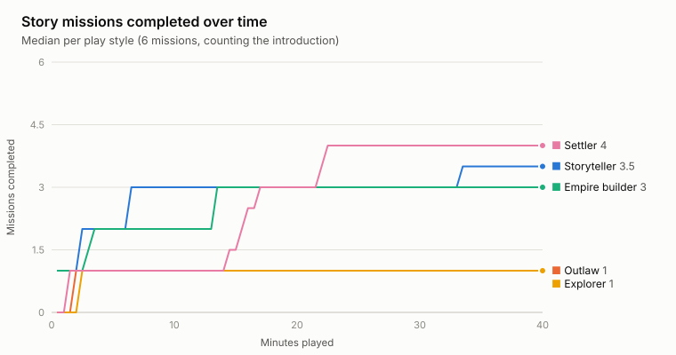
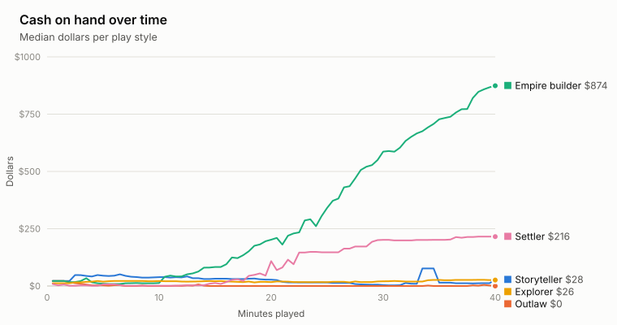
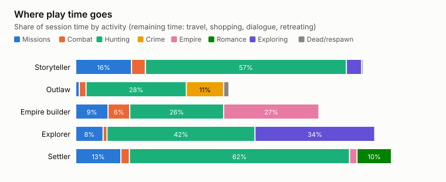
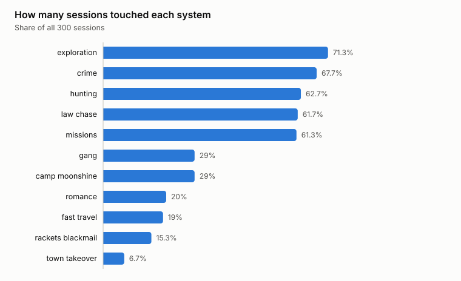
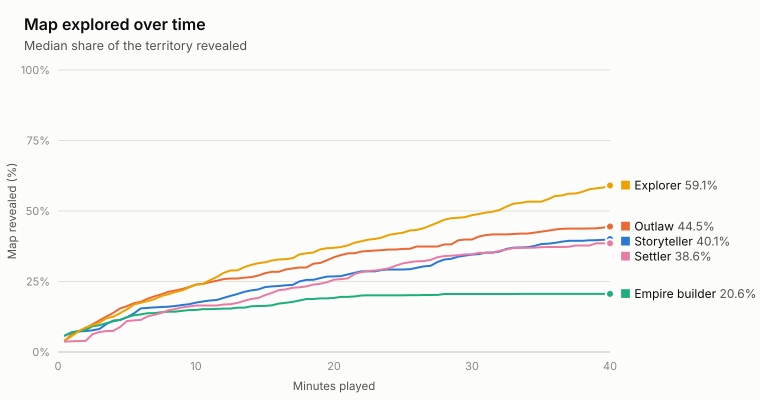
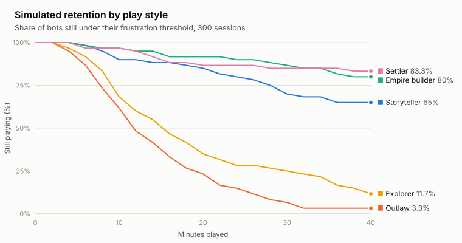

# What 300 Scripted Players Found in a Browser Western

**A simulated playtest of *Dust & Iron*: defects, dead ends and balance signals from 200 hours of bot play**

*Draft for author validation · November 2026*

---

## Abstract

We ran the real code of *Dust & Iron*, an open-world Western played in the browser, headless in Node.js and had scripted bots play 300 sessions of 40 simulated minutes each: 200 hours of play in under ten minutes of wall-clock time. Five hand-authored play styles (story-focused, outlaw, empire builder, explorer and settler) were crossed with three levels of aiming skill, 20 seeded sessions per cell. Every session logged a timeline of game events, which we summarised as activity density, system reach, progression, friction and a modelled "would quit" signal.

The study found one game-breaking defect, since fixed: a mission objective could never complete if its targets were killed from outside the mission area. It also found a resource-exhaustion dead end. In 59 of 240 non-criminal sessions (25%, 95% CI 20–30%) the bot ran out of ammunition and money at a median of 6.7 minutes, and only 4 of those 59 ever recovered. Among story-focused bots the unrecovered rate was 38% (27–51%). Other signals were a law response that ended 95% of the scripted outlaw's chases in death, an empire path whose scripted build order reached the top rank in a median 12.5 minutes, and repeat collision hotspots in town and at mesa rims.

Three independent reviews (design, methods and adversarial) checked every headline against the raw data. Several first-draft claims were withdrawn or narrowed, and we report the corrected versions. Because the players are scripts, these results identify defects and generate hypotheses. They do not measure how people experience the game.

---

## 1. Introduction

Small teams rarely get hundreds of hours of playtesting before release. Automated agents can't tell you whether a game is fun, but they can cover a lot of ground quickly: they reach states that break progression, expose economic dead ends, and find places where movement fails. This paper reports what such a pass found in *Dust & Iron* and, just as importantly, how far each finding can be trusted.

The game has six story missions and a set of optional systems that build on each other: hunting, crime and a bounty-driven law response, a gang, desert camps with moonshine stills, protection rackets, blackmail, courtship and marriage, fast travel, and a three-wave raid that seizes the town. A player's rank rises with influence, from Drifter to Don of the Territory.

## 2. Method

### 2.1 Running the game without a browser

The harness (`playtest/harness/env.mjs`) extracts the game's module script from `index.html` and runs it in Node with npm `three@0.160.0`, the same version the game loads from its CDN. A thin layer stands in for the DOM. A no-op renderer replaces WebGL, so all game logic runs but nothing is drawn. The game's `setTimeout` and `setInterval` calls are redirected to a simulated clock, so timed events such as respawn delays follow game time. Each session imports a fresh copy of the module with its own seeded `Math.random`. Simulation runs at 20 ticks per simulated second and costs about 0.2 ms per tick, so one 40-minute session takes about 10 seconds, and 14 worker threads ran all 300 in 9 minutes.

### 2.2 The bots

Bots use the same inputs a person does: they hold movement keys, turn the camera to steer on foot, use A and D to steer the horse, aim by setting the camera angles, pull the trigger, and pick options from the same menus and E-key interactions (`playtest/harness/bot.mjs`). Aim error is Gaussian, with σ = 0.045, 0.025 and 0.012 rad for novice, average and expert. Expert bots also use the Focus slow-motion marking ability against groups. All bots share some basic habits: buying ammo and a tonic before a fight, looting bodies, retreating when out of ammo or badly hurt, setting aside an objective for five minutes after dying three times on it, and steering around an obstacle after getting stuck.

| Persona | What its planner pursues |
|---|---|
| Storyteller | The current mission objective; hunts or explores when there is none |
| Outlaw | Robbery (people, stores, the bank), horse theft and assault; flees when wanted; sometimes pays off bounties |
| Empire builder | Camp → moonshine still → hires and recruits → moonshine sales → rackets → blackmail → raid on the town |
| Explorer | Unrevealed parts of the map, hunting and fast travel |
| Settler | Courtship (daily chats, gifts, ring, proposal), then a camp and still, then the story |

The bots were refined over three 10–20-session pilot runs (Section 6). The 300 sessions reported here ran after all changes were made.

### 2.3 Measures

Telemetry is sampled once per simulated second (`session.mjs`). We use the following terms deliberately:

- **Activity density.** Events per minute that change the player's situation: mission steps, kills, crimes, purchases, discoveries, rank-ups and similar.
- **System reach.** Which of 11 systems a session touched at least once.
- **Resource exhaustion.** Holding no ammunition, under $4, and nothing to sell, for 60 seconds or longer. We call this "exhaustion", not "soft-lock", because it is not proven to be inescapable.
- **Stuck episode.** The bot wanted to move but travelled under 1.2 m in 4 seconds. Repeats within 20 m and 30 s count as one episode.
- **Would quit.** A frustration score that builds each minute from deaths (×3), stuck events (×1.5), exhaustion (×4) and minutes with no meaningful event (×2). It falls 20% a minute and drops by 2 for each major reward. A bot "would quit" the first time the score passes its patience threshold, drawn between 10 and 16. **These weights are our own invention, not measurements of people.** Section 5 shows how far the results move when they change. Every bot actually played the full 40 minutes.

Proportions carry Wilson 95% intervals. Every interval reflects variation across random seeds for fixed bot policies, not variation across people.

## 3. Results

All 300 sessions completed with no crashes and no script errors raised by the game.

### 3.1 Defects found

**Mission objectives that could never complete (fixed).** In a pilot run, a story-focused expert shot the Dry Creek outlaws from more than 50 m away, before the game registered its arrival. Kills only advanced a mission during the "clear them out" step, so the counter read "6/6" and the mission never finished. The same could happen at Gray Ridge and with Silas Crane at Iron Hollow. Each kill objective now also checks its completion condition directly, and the fix shipped in game version 7 before the main run.

**A reputation price trap.** Robbery pushes honor below −40, and that raises shop prices by 30%. A broke outlaw holding $4 cannot afford ammo that now costs $5. This was found while debugging a bot that tried the same purchase on every tick.

### 3.2 Resource exhaustion

| Group | Hit exhaustion | Recovered to ≥ $10 | Median onset |
|---|---|---|---|
| Outlaw bots | 58/60 (96.7%, 88.6–99.1) | 55 | 7.2 min |
| All other bots | 59/240 (24.6%, 19.6–30.4) | 4 | 6.7 min |

Never recovered, by persona: storyteller 38.3% (27.1–51.0), settler 28.3% (18.5–40.8), empire 15.0% (8.1–26.1), explorer 10.0% (4.7–20.1).

The rules make this reachable. The player starts with $12 and 36 rounds. Every reliable way to earn money uses bullets: missions, hunting, and looting bodies (6 rounds each). Death takes 10% of the player's cash and gives no ammunition back. Outlaw bots recovered because robbery needs no bullets. The non-criminal bots never try robbery or other bullet-free income, so for people these rates are an **upper bound**. Even so, a third of story-focused sessions ending up with no way to continue is the most serious finding in this study.

### 3.3 Getting started and the story

184 of 300 sessions (61.3%, 55.7–66.7) completed a first real mission within 40 minutes. Among those that did, the median was 3.3 minutes. Counting the rest as unfinished at 40 minutes, the median across all sessions is 14.2 minutes; for storytellers alone it is 2.5 minutes. Completion rose with aim: novice 45%, average 63%, expert 76%. Bots move straight to known coordinates and never read the interface, so this says nothing about whether people understand what to do. 40% of storytellers finished all six missions.



### 3.4 The law

Scripted outlaws were wanted 883 times, and 836 of those chases (94.7%, 93.0–96.0) ended in death. They never paid off a bounty. Death collects the bounty from cash, which is why their median end money was $0. The rules are punishing on their own. Reinforcement deputies spawn 85–105 m from the player's *current* position every 14 seconds, and they keep resetting the 18 seconds out of sight that escape requires. But the outlaw planner adds to that: it re-offends immediately, fights back only within 22 m, and its bounty-payment rule almost never fires. What this supports is: **the law response is very punishing for reckless crime.** It does not show that criminal play is unsustainable for people. Death causes are labelled "lawmen" whenever the player was wanted, regardless of who fired.

### 3.5 Where the money came from

Our first draft said hunting was the economy. That claim is withdrawn. Hunting fills 26–62% of bot time across personas because it is every planner's fallback goal, and bots stuck in resource exhaustion "hunt" with an empty gun. Recorded income tells a different story. Summed over each persona's 60 sessions, looted bodies brought in $1,056 (explorer) to $28,151 (empire), and outlaws took $19,291 from robbery. Empire bots also sold moonshine. Ending cash diverged sharply: median $874 for empire builders and $216 for settlers, against $0–28 for the rest.





### 3.6 Progression and system reach

Empire bots touched the most systems (6.3 of 11). Following a fixed, near-optimal build order, 24 of 60 (40%, 28.6–52.6) reached Don of the Territory, at a median of 12.5 minutes (13 of 20 with expert aim, 5 of 20 novice). That is the shortest a scripted optimal route takes, not typical progress. Even so, money still rising at minute 40 with nothing left to buy suggests the late game needs things to spend money on. 38 of 60 settlers married.

Across all sessions, the share touching each system was:

| System | Share of sessions | System | Share of sessions |
|---|---|---|---|
| Exploration ≥ 30% of map | 71% | Camp or moonshine | 29% |
| Crime | 68% | Romance | 20% |
| Hunting | 63% | Fast travel | 19% |
| Law chase | 62% | Rackets or blackmail | 15% |
| A story mission | 61% | Town takeover | 7% |
| Gang | 29% | | |

These shares follow from the even 20% persona mix. They are not a forecast for any real audience.



### 3.7 Movement

Merging repeats, bots had 2,118 stuck episodes (10.6 per hour). Explorers had the most, 19.8 per hour, because they ride in straight lines toward random unexplored cells. 78% of stuck events happened on horseback. The same places recurred across sessions. One cell just north of the town centre caught bots in 87 separate sessions, and two cells along the southern rim of the mesa west of town caught 56 and 54. These are candidate collision hotspots to check by hand. Part of each count is the bot's own simple steering.



### 3.8 Simulated retention

| Persona | Would quit within 40 min | Persona | Would quit within 40 min |
|---|---|---|---|
| Settler | 16.7% (9.3–28.0) | Explorer | 88.3% (77.8–94.2) |
| Empire builder | 20.0% (11.8–31.8) | Outlaw | 96.7% (88.6–99.1) |
| Storyteller | 35.0% (24.2–47.6) | | |



Read this table only as an ordering. Section 5 shows why the percentages themselves can't be trusted. The empire figure is partly built into the model: the empire planner is scripted to produce the reward events the model credits (7.2 per session, against 4.0 for storytellers).

## 4. Design recommendations

Ordered by how directly the evidence supports them:

1. **Give players a way back after death.** Restock at least 12 revolver rounds on respawn, and skip the 10% cash penalty when the player has under $20. *Evidence: §3.2. This should remove most unrecovered exhaustion.*
2. **Add income that needs no bullets.** For example, odd jobs posted at the Mercantile or chores at the Delgado Ranch. *Evidence: §3.2.*
3. **Make escape from the law possible.** Spawn reinforcements around where the player was last seen, not where they are now, and stop spawning while the search timer runs. Add surrender for the bounty plus a fee. *Evidence: §3.4. Also needs testing with people.*
4. **Re-check robbery payouts against bounties.** At present every witnessed robbery loses money once death collects the bounty. Also reconsider how the reputation price markup combines with exhaustion. *Evidence: §3.1, §3.4.*
5. **Add late-game things to spend money on**, such as higher still levels, property or bribes in the $200–500 range, and check the pace from rank to rank with people. *Evidence: §3.6.*
6. **Inspect the repeat collision cells** in town and at the mesa west of town, then fix the colliders. *Evidence: §3.7.*

## 5. Limitations

All data come from scripted agents, not human participants. The personas are hand-written policies, so differences between them largely reflect the policies we wrote rather than how players would choose to play. Persona alone accounts for 85% of the variance in deaths per hour, 47% in modelled quitting and 40% in missions completed; aim skill accounts for 1–6% (`analysis/variance.mjs`). "Skill" varies only aim noise. Activity density and system reach describe activity under these policies. They are not measures of player engagement, enjoyment or retention.

"Would quit" is the output of an unvalidated frustration model applied after the fact. Under 200 joint draws that perturb its weights by ±50%, its decay between 0.7 and 0.9, and its patience thresholds by ±4, the overall rate ranges from 17% to 85% (5th–95th percentile, median 56%). The ordering held much better than the percentages: outlaw or explorer came out worst in 199 of 200 draws, and settler or empire came out best in 200 of 200. Two single-factor checks show how much depends on the model's choices. Giving stuck events zero weight drops explorer quitting from 88% to 3%. Giving idle minutes zero weight drops storyteller quitting from 35% to 17%. The explorer's poor retention is therefore an artefact of the stuck detector, not a finding about exploration.

Stuck events reflect both the map's geometry and the bots' straight-line steering, so they are candidate hotspots that need checking by hand. "Resource exhaustion" names a state the bots reached, not a proven dead end. The death-cause label "lawmen" means only that the player was wanted at the time. Fast-travel events were logged twice on 50 occasions, which slightly inflates activity density for explorers. The bots were tuned over three pilot runs before the main run, and we fixed the mission defect between the pilots and the main run.

These results are suitable for finding defects and places players can't reach, and for generating hypotheses to test with human playtesters. They should not be used to estimate how people will play.

## 6. Process and review

The pilots changed the bots before the main run in five ways:
- they stopped charging an outlaw camp repeatedly and started retreating and setting objectives aside
- they began shooting enemies who hadn't noticed them, looting bodies and selling hides
- they stopped sitting in a menu after a purchase failed
- they started logging purchases only when money actually changed hands
- they started checking reputation-adjusted prices

One full 300-session run was discarded because purchase logging inflated outlaw activity about thirtyfold.

Three agents reviewed the draft findings independently: a design reviewer working from the code, a methods reviewer, and an adversarial reviewer who recomputed every headline from the raw events. Withdrawn or corrected after review:

- the claim that hunting is the economy
- "outlaw play is unsustainable" (narrowed to the law response for reckless crime)
- "empire has the lowest quit rate" (settler does)
- a 3.3-minute onboarding median that ignored the 39% who never finished a mission
- an explorer stuck rate of 38 per hour that counted repeats
- a single headline quit percentage

Every number here can be regenerated from `playtest/data/sessions.jsonl` with `analysis/analyze.mjs` and `analysis/verify.mjs`.

## 7. Conclusion

The bots did what bots are good at. In 200 hours of play they found a progression-breaking defect, a common path to having no money and no bullets, a law response that leaves reckless players almost no way out, and specific walls the bots kept running into. They could not tell us whether the game is fun, how long people would play, or which path players would choose. The next step is a small human playtest focused on the first 20 minutes: whether story-focused players get stranded without money or bullets, and whether being wanted feels like a chase or a death sentence. It should run after recommendations 1–3 are in place.

---

### Reproducing this study

```bash
cd playtest && npm install
node harness/run.mjs 300 40 data/sessions.jsonl
node analysis/analyze.mjs data/sessions.jsonl
node analysis/verify.mjs data/sessions.jsonl
node analysis/variance.mjs analysis/per-session.csv
```

Sessions are seeded (`seed = 1000 + 7919 × id`), so reruns of the same code reproduce the same play.
